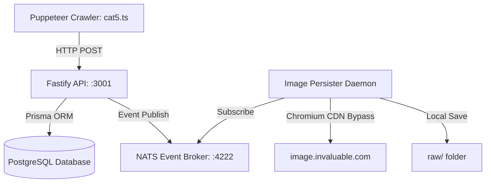

# Art Scraper Monorepo 🎨🚀

A high-performance, resilient microservices-based web crawler and image archiving system built to bypass CDN hotlink protections and Cloudflare TLS/JA3 checks.

---

## 🏗️ Architecture Flow



1. **Crawler (`packages/crawler`)**: Uses a real, headless Chrome instance (via Puppeteer) to authenticate with invaluable.com, query `/catResults` via injected AJAX context, extract 15+ rich metadata fields, and POST them to the API.
2. **API (`packages/api`)**: Receives artwork batches, performs unique deduplication, writes metadata to PostgreSQL via Prisma ORM, and publishes a `artworks.new` event to NATS.
3. **Image Persister (`packages/img-persister`)**: Listens to the NATS queue, spins up a dedicated Chromium session to bypass Cloudflare CDN TLS checks, downloads standard images to `raw/`, and attempts high-resolution `_original` suffix copies.

---

## ⚡ Quick Start (Setup)

Ensure you have **Node.js**, **Docker**, and **pnpm** installed.

### 1. One-Step Setup
Run the unified setup command to install workspace dependencies, spin up the Docker infrastructure, and push the database schema:
```bash
pnpm setup
```

*(Alternatively, run the steps manually as detailed below).*

### 2. Manual Setup Steps
```bash
# A. Install monorepo dependencies
pnpm install

# B. Spin up PostgreSQL and NATS services in Docker
pnpm infra

# C. Push the database schema using Prisma ORM
pnpm db:push
```

---

## 🏃 Running the Services

Open separate terminal sessions to start the microservice components:

### 1. Start the API Service
Runs on port `3001` with hot-reloading active.
```bash
pnpm api
```

### 2. Start the Image Persister Daemon
Subscribes to the NATS message broker and downloads incoming images.
```bash
pnpm persister
```

### 3. Run the Crawler
Launches the advanced Puppeteer-based scraper to crawl a batch of records.
```bash
pnpm crawl
```

---

## 🛠️ Management & Utilities

*   **View Database UI (Prisma Studio)**: Run `pnpm db:studio` to open an interactive data viewer in your browser at `http://localhost:5555`.
*   **Stop Docker Infrastructure**: Run `pnpm infra:down` to spin down the PostgreSQL database and NATS message broker containers.
*   **Build Chrome Extension**: Run `pnpm build:ext` to package the web extension helper into a zip file.
